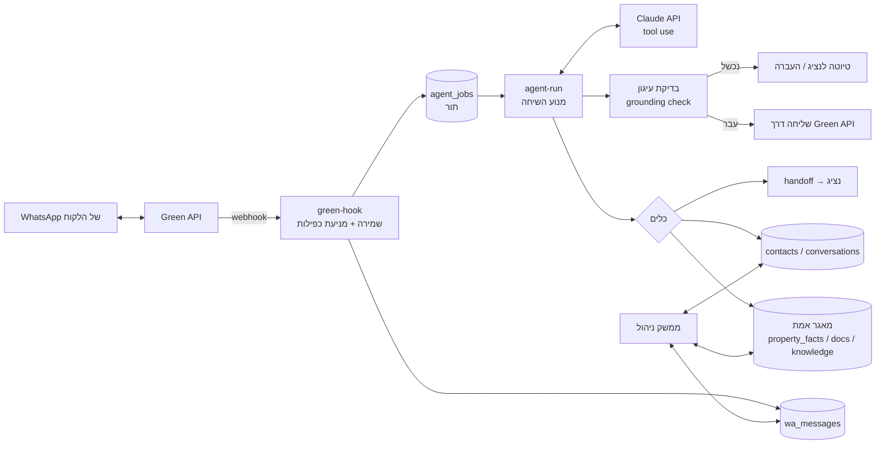
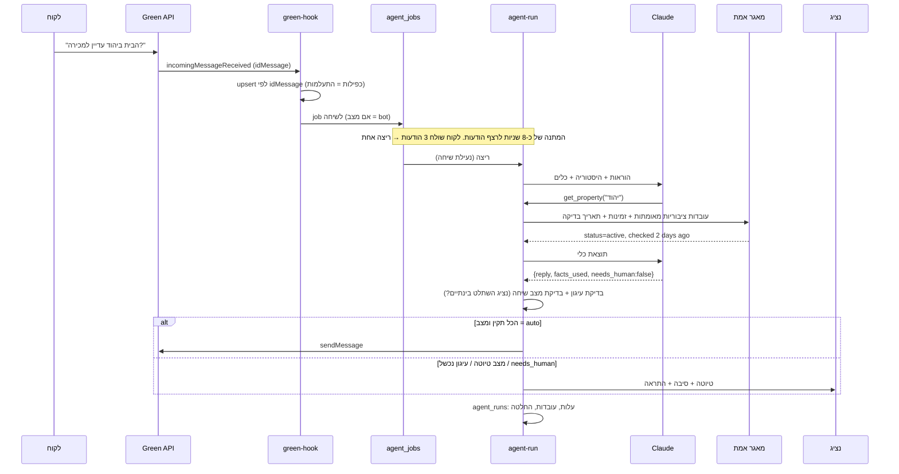

# סוכן נדל״ן דיגיטלי: ארכיטקטורה ותוכנית MVP

> מסמך תכנון לאישור לפני פיתוח, לפי סעיף 19 באפיון. לא נכתב קוד.
> נכתב על בסיס בדיקה של המערכת הקיימת (קוד, מסד נתונים, חיבורים) ב-25 באוקטובר 2026.
> שמות טכניים נשארו באנגלית.

---

## 0. תקציר

**ההמלצה:** לא בונים מערכת חדשה. מוסיפים "שכבת סוכן" למערכת הקיימת. כבר יש לנו רוב החלקים:

- חיבור וואטסאפ חי: כל הודעה נשמרת תוך שנייה.
- CRM עם שלבים, משימות ותזכורות.
- מאגר נכסים, מערכת תיאום פגישות, תבניות, התראות.
- שימוש קיים ב-Claude לניתוח לידים.

מה שחסר הוא בדיוק הלב של האפיון:

1. **מאגר אמת מאומת:** לכל נתון יש מקור, מאמת, תאריך והרשאה להצגה.
2. **מנוע שיחה עם כלים:** שולף רק מהמאגר ולא ממציא.
3. **ניהול שיחה ומצב:** בוט, נציג או מושהה, כולל העברה לנציג.
4. **הרשאות משתמשים אמיתיות.**

**MVP מוצע:** סוכן אחד (לא שישה), עם כלים ייעודיים. הוא מתחיל ב**מצב טיוטה**: הבוט כותב תשובה, נציג מאשר בלחיצה, ורק אחרי שהאיכות נמדדה עוברים לשליחה אוטומטית. זה הדרך הבטוחה לעמוד ב"אפס המצאות".

### החלטות שמחכות לך

| # | החלטה | ההמלצה שלי |
|---|---|---|
| 1 | היקף: רק אפיק הנחל, או גם קבוצת קורקוס? | מנוע אחד עם שדה `brand`. מתחילים בנכסי אפיק הנחל (13 נכסים), וקורקוס מצטרפת בשלב 3 |
| 2 | איך עולים לאוויר | שבועיים במצב טיוטה. אחר כך שליחה אוטומטית רק לשאלות שיש להן תשובה מאומתת, ושאר השיחה נשארת טיוטה |
| 3 | הבוט מציג את עצמו | בהודעה הראשונה של הבוט בכל שיחה: "אני העוזר הדיגיטלי של אפיק הנחל" (כלל 14 באפיון) |
| 4 | מודל AI | Claude Opus 5.5 כברירת מחדל. ההחלטה אם לעבור למודל זול יותר (Sonnet 5.5, בערך חצי מחיר) תתקבל אחרי מדידה בפיילוט, והיא שלך |
| 5 | שדרוג תשתית | Supabase Pro ‏($25 לחודש) ו-Vercel Pro ‏($20 לחודש). פירוט בסעיף 15 |
| 6 | משתמשים | רשימת אנשי הצוות ותפקידם (מנהל, מכירות, צפייה) |
| 7 | הבוט הישן על Meta Cloud API ‏(`api/whatsapp.js`) | לכבות. לא התקבלה בו אף הודעה נכנסת, והוא עונה בלי מאגר מאומת |

---

## 1. מה כבר קיים (ניתוח התשתית)

| רכיב באפיון | מה יש היום | פער |
|---|---|---|
| ערוץ וואטסאפ | Green API (תוכנית בתשלום). Webhook חי ב-`/api/meta/green-hook`, טבלת `wa_messages` (מזהה הודעה ייחודי, כיוון, סטטוס), אוטובוס שינויים ב-Realtime. ההגדרות נבדקות ומתוקנות מעצמן | חסר שיוך הודעה לכותב (בוט, איש צוות, אוטומציה), וחסר מצב שיחה |
| מנוע AI | `@anthropic-ai/sdk`, ו-`lib/claude-json.js` עם Structured Outputs. בשימוש לניתוח לידים, סיכום שיחה ומחקר ליד | אין לולאת כלים (tool use) לשיחה |
| מאגר נכסים | טבלת `properties` עם `data jsonb`, כ-90 שדות (מחיר, חדרים, שטח, גוש וחלקה, תמונות, PDF), דגל `published`. האתר, האשף והאדמין משתמשים בה | **אין מקור, אימות, תאריך אימות או הפרדה בין פנימי לציבורי לשום שדה.** שדות קרקע כמעט ריקים (`buildingRights` ב-2 נכסים מתוך 13) |
| ניהול לידים | `contacts` ‏(318 לידים, `crm_data jsonb`: שלבים, הערות, משימות, צרכים), `meta_leads` ‏(342), Lead Center, לוח לידים, כרטיס ליד | עובד. צריך רק חיבור לשיחה |
| אוטומציות | 61 תבניות דו־לשוניות, כללים, חלון שעות, הסרה ("לא תודה"), תור אישור | נשאר כמו שהוא. הבוט לא שולח הודעות יזומות |
| פגישות | `/book`: יומן Google, בדיקת זמינות, אישורים | הבוט יכול להציע קישור כבר ב-MVP, וקביעת פגישה ישירה בשלב 3 |
| התראות לצוות | כרטיס, צליל, התראת דסקטופ ומונה בלשונית הדפדפן. מסנן "ממתינים לתשובה" | מוכן לשמש להעברה לנציג |
| תשתית | Vercel ‏(Hobby: 12 פונקציות, כולן בשימוש, 60 שניות לפונקציה). Supabase ‏(Free, `pg_cron`, `pg_net`) | חוסר מקום לפונקציות. מגבלות תוכנית חינמית (סעיף 16) |
| משתמשים והרשאות | **אין.** סיסמת מנהל אחת משותפת | **פער קריטי** (סעיף 12) |

**המסקנה:** המערכת הקיימת היא בסיס טוב. לא צריך n8n, Make, CRM חיצוני או מסד וקטורי ב-MVP.

---

## 2. ארכיטקטורה

**עקרונות:**

1. **ה-AI רק מנסח.** מחיר, זמינות וזכויות מגיעים מכלים שקוראים מהמאגר. המודל לא "יודע" אותם.
2. **בדיקת עיגון דטרמיניסטית לפני כל שליחה:** קוד, לא מודל, בודק שכל מספר, מחיר ושטח בתשובה מופיעים בעובדות שנשלפו באותה ריצה. אם לא, התשובה לא נשלחת.
3. **שיחה אחת, כותב אחד.** נעילה לכל שיחה, ומצב שיחה מגדיר מי מדבר: בוט, נציג או אף אחד.
4. **הכל מוחלף.** ספק ה-AI מאחורי מודול אחד, וגם ספק הוואטסאפ. אפשר לעבור ל-Meta Cloud API הרשמי בלי לגעת במאגר.
5. **בלי פונקציות Vercel חדשות.** כל נקודות הקצה דרך `api/meta.js`, כמו היום.

---

## 3. זרימת הודעה: מוואטסאפ ועד תשובה

**נקודות חשובות:**

- **המתנה לרצף הודעות:** הריצה מתחילה רק כשעברו כ-8 שניות בלי הודעה חדשה, כך שהבוט עונה פעם אחת על כל מה שהלקוח כתב.
- **בדיקה אחרונה לפני שליחה:** אם בזמן הריצה נציג שלח הודעה, או שהלקוח כתב שוב, התשובה נזרקת והריצה מתחילה מחדש.
- **תקלות:**
  - Claude לא זמין: שלושה ניסיונות, ואחר כך הודעה לנציג.
  - Green לא זמין: ההודעה נשמרת ומנוסה שוב.
  - אף הודעה לא נעלמת. כל job נשאר עם סטטוס ושגיאה.

---

## 4. מבנה נתונים

הכל ב-Postgres הקיים (Supabase). טבלאות חדשות מסומנות **חדש**, וטבלאות קיימות שמתרחבות מסומנות **הרחבה**.

| טבלה | תפקיד | שדות עיקריים |
|---|---|---|
| `properties` (קיים) | הנכס כפי שהאתר מציג | נשאר, האתר לא משתנה |
| `property_facts` **חדש** | עובדה מאומתת אחת | `property_id`, `key` (price, rooms, availability, building_rights_approved…), `value jsonb`, `unit`, `visibility` (public / internal), `source` (manual / excel / pdf / site / official_doc), `source_ref`, `verified_by`, `verified_at`, `valid_until`, `status` (current / superseded / disputed), `supersedes` |
| `property_documents` **חדש** | מסמכים, תוכניות ומדיה | `property_id`, `kind`, `url`, `title`, `shareable bool`, `extracted_text`, `summary`, `verified_by/at` |
| `knowledge_items` **חדש** | ידע כללי מאושר: שירותים, שאלות נפוצות, תהליך רכישה, מושגים | `topic`, `question`, `answer_he`, `answer_en`, `visibility`, `verified_by/at`, `brand` |
| `review_queue` **חדש** | כל מה שדורש אדם | `kind` (conflict / missing / customer_correction / unanswered / stale), `property_id`, `conversation_id`, `payload`, `status`, `resolved_by/at` |
| `conversations` **חדש** | שיחה אחת לכל מספר | `phone` (unique per brand), `contact_id`, `meta_lead_id`, `brand`, `mode` (bot_draft / bot_auto / human / paused), `status` (open / waiting_us / waiting_customer / needs_human / closed), `assigned_to`, `needs_human_reason`, `summary`, `open_questions jsonb`, `property_ids`, `bot_paused_until`, `locked_until` |
| `wa_messages` (**הרחבה**) | הודעות (קיים, כבר עם מזהה ייחודי) | `conversation_id`, `author` (lead / bot / staff:<id> / automation / phone), `agent_run_id` |
| `agent_jobs` **חדש** | תור עבודה לכל שיחה | `conversation_id`, `trigger_ids`, `run_after`, `status`, `attempts`, `error`. Unique על (conversation, last trigger) |
| `agent_runs` **חדש** | תיעוד מלא של כל ריצה | `model`, `tokens in/out/cache`, `cost_usd`, `tools jsonb`, `facts_used`, `draft`, `decision` (sent / draft / handoff / skipped / blocked), `grounding jsonb`, `latency_ms`, `error` |
| `staff` + `roles` **חדש** | משתמשים אמיתיים | Supabase Auth uid, שם, טלפון להתראות, `role` (admin / sales / viewer) |
| `conversation_assignments` **חדש** | היסטוריית שיוך והשתלטות | `conversation_id`, `from`, `to`, `by`, `at`, `reason` |
| `audit_log` **חדש** | כל פעולה מהותית | `actor`, `action`, `entity`, `before`, `after`, `at` |
| `contact_prefs` **חדש** | הסכמות והסרה, ממרכזים את מה שהיום ב-`crm_data.auto.optOut` | `phone`, `opted_out`, `bot_allowed`, `consent_marketing`, `source`, `at` |
| `appointments`, `tasks` | **קיים** ב-`app_settings.booking_log` וב-`crm_data.tasks` | לא מזיזים ב-MVP |

**אילוצים:**

- עובדה "נוכחית" אחת לכל (`property_id`, `key`): partial unique index על `status='current'`.
- שתי עובדות סותרות מאותו `key` (למשל מחיר מ-PDF מול מחיר בממשק) הופכות ל-`disputed` ונכנסות ל-`review_queue`. הבוט לא מציג עובדה במצב `disputed`.
- RLS פעיל בכל הטבלאות, וגישה רק דרך השרת.

**שדות קרקע** (keys ב-`property_facts`, בלי עמודות קשיחות):

- `gush`, `helka`, `area_sqm`, `area_dunam`
- `ownership` (private / lease / other)
- `zoning_current` + `zoning_source`, `plan_number`, `planning_stage`
- `building_rights_approved` **בנפרד מ-**`building_rights_potential`
- `restrictions`, `expropriation`
- `price`, `price_per_dunam`, `extra_costs`

---

## 5. API ו-Webhooks

כל הנתיבים בתוך `api/meta.js` (`/api/meta/<action>`). אין פונקציה חדשה.

| נתיב | מי קורא | מה עושה |
|---|---|---|
| `POST green-hook` (קיים) | Green API | שמירת הודעה וסטטוס. **הרחבה:** יצירת או עדכון `conversation` ו-`agent_jobs`, וזיהוי "נציג כתב מהטלפון" (`outgoingMessageReceived`), שמעביר את השיחה ל-`human` |
| `POST agent-run` (חדש, מפתח פנימי) | `pg_net` מתוך trigger, או `waitUntil` | הרצת job אחד: נעילה, Claude, כלים, בדיקת עיגון, החלטה |
| `GET/POST agent-config` | אדמין | הפעלה וכיבוי כללי (kill switch), מצב ברירת מחדל, שעות, נושאים מותרים לשליחה אוטומטית, מודל ו-effort |
| `GET conversations` · `GET/PATCH conversation` | אדמין | תיבת שיחות: סינון לפי סטטוס, שינוי מצב (bot / human / pause), שיוך, סגירה |
| `POST conversation-takeover` / `-release` | נציג | השתלטות ושחרור. כל אחד מהם נרשם ב-`audit_log` |
| `POST agent-draft-send` | נציג | שליחת טיוטת הבוט, כמו שהיא או אחרי עריכה. העריכה נשמרת לשיפור |
| `GET/PUT property-facts` · `POST fact-verify` | אדמין | מאגר אמת: עריכה, אימות, הרשאה להצגה, היסטוריה |
| `POST property-import` | אדמין | ייבוא Excel או CSV. כל שורה נכנסת "לא מאומתת", ואדם מאשר |
| `POST property-doc` | אדמין | העלאת PDF. חילוץ טקסט וסיכום, שמורים לבדיקה ולא נכנסים אוטומטית כעובדה |
| `GET review-queue` · `POST review-resolve` | אדמין | סתירות, חוסרים, תיקוני לקוח, שאלות שלא נענו |
| `GET agent-metrics` | אדמין | מסך ביצועים |
| `POST agent-eval` | אדמין | הרצת מערך הבדיקות (סעיף 13) מול המודל האמיתי, עם מגבלת עלות |

**אימות:** אחרי שלב 0, כל נתיב אדמין דורש JWT של Supabase Auth ובדיקת תפקיד. נתיבים פנימיים דורשים מפתח שנוצר במסד ונבדק בהשוואה קבועת־זמן, כמו `remind_key` ו-`green_hook_key` היום.

---

## 6. Green API: תוכנית חיבור ומגבלות

**מה כבר עובד:**

- קבלת כל ההודעות והסטטוסים ב-webhook מאובטח, עם מזהה הודעה ייחודי שמונע כפילות.
- שליחת טקסט, תמונה וקובץ (`sendFileByUrl`).
- טיפול ב-429 ובמכסה, ובדיקה ותיקון עצמיים של ההגדרות.

**מה מוסיפים:**

| דרישה באפיון | איך |
|---|---|
| זיהוי מי כתב | `outgoingAPIMessageReceived` = נשלח מהמערכת: ה-`agent_run_id` או המשתמש נרשמים בזמן השליחה. `outgoingMessageReceived` = נשלח **מהטלפון** = נציג, והשיחה עוברת ל-human אוטומטית |
| תור והגבלת קצב | `agent_jobs`. עד הודעה אחת בשנייה לכל המופע, ותשובה אחת לשיחה בכל רגע |
| ניסיונות חוזרים | שליחה שנכשלה: 3 ניסיונות (שנייה, 5 שניות, 30 שניות). אחר כך הודעה לנציג |
| מדיה נכנסת | תמונה או קובץ מלקוח נשמרים ב-`wa_messages.file_url`. הבוט לא "קורא" אותם כהוראות (סעיף 12). ב-MVP מסמך מלקוח הוא סיבה להעברה לנציג |
| קבוצות | הבוט לא עונה בקבוצות, רק בשיחות 1:1 (`@c.us`) |

**מגבלות שחשוב להכיר:**

- **Green API אינו ממשק רשמי של WhatsApp.** הוא עובד על חשבון WhatsApp רגיל. Meta יכולה לחסום מספר שמתנהג כמו בוט שולח הודעות. כדי להקטין את הסיכון:
  - הבוט **רק עונה** להודעות נכנסות, בלי הודעות יזומות.
  - הודעות קצרות, בקצב אנושי.
  - שומרים את Meta Cloud API הרשמי כתוכנית חלופית (כבר יש מספר מחובר).
- **התוכנית לפי מופע:** כל מספר וואטסאפ הוא מנוי נפרד. קבוצת קורקוס עם מספר משלה = מנוי נוסף.
- **הטלפון של המשרד ממשיך לקבל הכל.** נציג יכול לענות מהטלפון, ולכן הזיהוי האוטומטי של "נציג ענה" הוא קריטי.

---

## 7. כלי AI ואוטומציה חיצוניים: בחינה

| כלי | תפקיד אפשרי | המלצה ל-MVP | נימוק |
|---|---|---|---|
| **Claude API** (Anthropic) | מנוע השיחה | **כן** | כבר בשימוש, יש מפתח ב-Vercel. Tool use, Structured Outputs, Hebrew. `fallbacks: "default"` לסירוב |
| n8n / Make | תזמור תהליכים | **לא** | התור, התזמון (`pg_cron`) והקריאות (`pg_net`) כבר קיימים במסד. כלי נוסף מוסיף נקודת כשל, סודות במקום נוסף ועלות, בלי יכולת חדשה. אפשר לחבר בעתיד דרך webhooks |
| CRM חיצוני | ניהול לידים | **לא** | ה-CRM הקיים מכסה את מסך הלידים באפיון. סנכרון דו־כיווני רק אם תחליט על CRM אחר |
| מסד וקטורי / embeddings | חיפוש סמנטי | **לא ב-MVP** | 13 נכסים ומעט מסמכים: חיפוש מובנה + טקסט מלא מספיקים ומדויקים יותר. כשיהיו מאות מסמכים: `pgvector` (כלול ב-Supabase) + ספק embeddings (Anthropic לא מציעה). נבחן בשלב 3 |
| יומן | פגישות | **קיים** | `/book` ו-Google Calendar. ב-MVP הבוט שולח קישור, ובשלב 3 קובע ישירות |
| סנכרון אתר | נכסים | **קיים** | טבלת `properties` היא מקור האתר. `property_facts` נשענת עליה |

---

## 8. שליפת מידע ואימות (RAG)

**שלוש שכבות, בסדר הזה:**

1. **זיהוי הנכס:**
   - לפי מזהה: הקישור `/p/<id>`, קמפיין המודעה של הליד, או נכס שהוזכר קודם בשיחה.
   - אם אין מזהה, לפי שם, עיר או רחוב. כשיש יותר מנכס מתאים אחד, הבוט **שואל** ולא מנחש.
2. **שליפה מובנית:**
   - `get_property(id)`: רק עובדות `current` + `public`, כל אחת עם `verified_at` ו-`fact_id`.
   - `search_properties(filters)`: סינון בקוד לפי מחיר, עיר, חדרים, סוג וסטטוס. לא סינון במודל.
3. **ידע כללי ומסמכים:** `search_knowledge(q)`, חיפוש טקסט מלא ב-`knowledge_items` ובסיכומי מסמכים מאושרים. ב-MVP בלי וקטורים.

**כללי טריות:**

- **זמינות:** נכס "זמין" רק אם `availability` אומת בתוך X ימים (ברירת מחדל 7, ניתן לשנות). אחרת: "יש לי את פרטי הנכס, אבל אין אישור עדכני לזמינות", ופתיחת בדיקה.
- **מחיר:** אם `valid_until` עבר, הבוט לא מציג את המחיר כעובדה.

**בדיקת עיגון לפני שליחה (קוד):**

1. המודל מחזיר `{ reply, facts_used: [fact_id…], needs_human, reason }`, דרך Structured Outputs.
2. הקוד מחלץ מהתשובה כל מספר, סכום, שטח, תאריך ומילות סטטוס ("זמין", "נמכר", "מאושר", "הפשרה"). כל אחד מהם חייב להופיע בעובדות ב-`facts_used` שנשלפו **באותה ריצה**.
3. רשימת ביטויים חסומים: "מובטח", "תשואה של", "יופשר", "הנחה של", "מאושר לבנות", אלא אם הם בעובדה מאומתת.
4. נכשל: לא נשלח. התשובה הופכת לטיוטה לנציג עם הסיבה, ונרשמת ב-`agent_runs.grounding`.

**ניהול ידע:** עדכון עובדה בממשק משפיע על התשובה הבאה מיד, בלי אימון מחדש. היסטוריית גרסאות נשמרת דרך `supersedes`. בדיקה תקופתית: כל לילה, נכס פעיל עם `availability` ישן נכנס ל-`review_queue`.

---

## 9. הסוכן: מבנה, כלים והוראות

**סוכן אחד, תפקידים כמצבים.** ששת הסוכנים באפיון הם תפקידים ולא שישה מודלים. לולאת tool use אחת עם כלים מוגבלים מכסה את כולם:

| תפקיד באפיון | איך ממומש |
|---|---|
| נציג מכירות ראשי | הלולאה עצמה + הוראות המערכת |
| מומחה נכסים | `get_property`, `get_documents` |
| התאמת נכסים | `search_properties` (סינון בקוד, ציון "למה מתאים" או "חורג מהתקציב") |
| מומחה קרקעות | אותם כלים + פסקת הוראות קרקע. שאלת זכויות או הפשרה = `handoff` |
| ניהול לידים | `update_lead_needs` (מציע עדכון תקציב, אזור וחדרים ל-CRM), `set_conversation_status` |
| שירות והעברה | `handoff(reason, summary, open_questions)` |

**כלים ב-MVP:**

- `get_property`, `search_properties`, `get_documents` (רק `shareable`), `search_knowledge`
- `get_lead_context`: **רק** הליד של השיחה הזו. אין כלי לחיפוש לקוחות אחרים, ולכן אין דרך לחשוף אותם
- `update_lead_needs`
- `share_booking_link`
- `send_property_media` (רק `shareable`)
- `handoff`, `log_unanswered`

**הגדרות המודל:**

- `claude-opus-5-5`, `effort` נמוך או בינוני (נמדד בפיילוט).
- System prompt קבוע ו-cached: ההוראות מסעיף 6 באפיון כמעט מילה במילה, ובנוסף סגנון הכתיבה של התבניות הקיימות (רבים, קצר, שאלה אחת).
- `fallbacks: "default"` למקרה של סירוב.
- תוכן שהלקוח שלח (טקסט, PDF, קישור) עובר למודל **כמידע מסומן**, אף פעם לא כהוראה.

**מה הבוט לא עושה ב-MVP:**

- לא שולח הודעות יזומות. מעקב נשאר באוטומציות הקיימות, עם הכללים וההסרה שלהן.
- לא משנה שלב בפייפליין מעבר ל"נוצר קשר".
- לא קובע פגישות. שולח קישור בלבד.
- לא משנה את מאגר האמת. תיקון של לקוח נכנס ל-`review_queue`.

---

## 10. העברה לנציג

**מצבי שיחה:**

| מצב | משמעות |
|---|---|
| `bot_draft` | הבוט כותב, אדם שולח |
| `bot_auto` | הבוט שולח בעצמו |
| `human` | הבוט שותק |
| `paused` | אף אחד לא שולח אוטומטית |

**מתי עוברים ל-`needs_human`:** כל המקרים בסעיף 11 באפיון. בנוסף:

- הבדיקה האוטומטית של התשובה נכשלה פעמיים.
- הלקוח שלח מסמך.
- הלקוח כתב "נציג", "בן אדם", "לדבר עם מישהו".
- זוהה כעס.

**מה קורה כשעוברים:**

1. השיחה עוברת ל-`needs_human` (עם הסיבה), והבוט נעצר מיד.
2. ללקוח נשלחת הודעה אחת: "העברתי את השאלה לצוות שלנו, נחזור אליכם". בלי זמן תגובה, אלא אם הוגדר.
3. הנציג המשויך, או כל הצוות, מקבל התראה: כרטיס, צליל ודסקטופ (נבנה היום), ובנוסף וואטסאפ למספר האישי.
4. בשיחה מוצג כרטיס העברה: סיכום, מה הלקוח מחפש, נכסים שהוזכרו, שאלות פתוחות ומה הבוט כבר אמר.
5. **השתלטות אוטומטית:** הודעה ראשונה של נציג, מהמערכת או מהטלפון, מעבירה את השיחה ל-`human`.
6. **שחרור:** רק נציג משחרר ("החזר לבוט"). שחרור אוטומטי אחרי X שעות בלי פעילות הוא אופציה כבויה כברירת מחדל.
7. **שאלות פתוחות:** אם אין נציג זמין, השאלה נשארת פתוחה ב"ממתינים לתשובה" (נבנה היום), עם זמן ההמתנה.

**אף פעם לא שני כותבים:** הבוט בודק את מצב השיחה ואת ההודעה האחרונה **ממש לפני** השליחה, לא רק בתחילת הריצה.

---

## 11. מסכי ניהול

הכל בתוך האדמין הקיים: עברית, RTL, טלפון ומחשב, בהיר וכהה.

| מסך | מה יש בו | בסיס קיים |
|---|---|---|
| **תיבת שיחות** (שדרוג "צ'אטים") | <ul><li>מסננים: ממתינים לתשובה, צריך נציג, בטיפול בוט, שלי</li><li>מצב השיחה כמתג</li><li>שיוך לנציג</li><li>כרטיס העברה</li><li>טיוטת הבוט מעל תיבת הכתיבה, עם "שלח", "ערוך" ו"למה?" (העובדות ששימשו)</li><li>כפתור עצירה לשיחה</li></ul> | הצ'אטים, המסננים, ההתראות |
| **מאגר אמת** (לשונית בכל נכס) | <ul><li>כל עובדה: ערך, מקור, מי אימת ומתי, ציבורי או פנימי, תוקף, היסטוריה</li><li>אימות בלחיצה</li><li>שדות חסרים מסומנים</li><li>תצוגה מקדימה של מה שהבוט רשאי לומר על הנכס</li><li>ייבוא Excel</li><li>העלאת מסמכים</li></ul> | עמוד הנכסים, האשף |
| **תור בדיקה** | סתירות, חוסרים, תיקוני לקוחות, שאלות שהבוט לא ידע לענות, עם פעולה ישירה מכל שורה | חדש |
| **ידע כללי** | שאלות ותשובות מאושרות (שירותים, תהליך רכישה, מושגים), עברית ואנגלית | חדש |
| **ביצועים** | <ul><li>פניות</li><li>זמן תגובה ראשון</li><li>% נענו ממידע מאומת</li><li>% הועברו לנציג</li><li>% טיוטות שנשלחו בלי עריכה</li><li>חסימות עיגון</li><li>שאלות בלי תשובה</li><li>עלות לשיחה ולליד</li><li>לפי נכס, מקור ומצב</li></ul> | סגנון "תמונת מצב" הקיים |
| **הגדרות סוכן** | <ul><li>כיבוי כללי (kill switch)</li><li>מצב ברירת מחדל</li><li>נושאים מותרים לשליחה אוטומטית</li><li>שעות</li><li>ימים לטריות זמינות</li><li>טקסט הצגה עצמית</li><li>מודל ו-effort</li></ul> | הגדרות האוטומציות |

---

## 12. אבטחה, הרשאות ופרטיות

**שלב 0, לפני שהבוט מדבר עם לקוח אחד:**

1. **משתמשים אמיתיים:**
   - היום: סיסמת מנהל אחת משותפת לכולם. אין דרך לדעת מי עשה מה, ואין הבדל בין מנהל לנציג. זה לא מתאים למערכת שמדברת עם לקוחות בשם החברה.
   - מעבר ל-Supabase Auth: כניסה עם Google או קישור במייל לכל איש צוות.
   - תפקידים: `admin`, `sales`, `viewer`. כל נתיב אדמין בודק JWT ותפקיד.
   - הסיסמה הישנה מבוטלת.
2. **סודות:**
   - הוצאת כל ערכי ברירת המחדל של מפתחות מהקוד. **הריפו ציבורי.**
   - החלפת כל מפתח שהופיע בו אי פעם.
   - הכל רק ב-Vercel env ובמסד.
3. **`audit_log`** לכל השתלטות, שליחה, עריכת עובדה, אימות ושינוי הגדרה.

**פרטיות ודין:**

- **הפרדה:** עובדות `internal`, הערות צוות ופרטי לקוחות אחרים לא נכנסים אף פעם לקונטקסט של המודל. הכלים מחזירים רק `public`, ורק את הליד של השיחה.
- **הזרקת הוראות:** טקסט של לקוח, מסמך או אתר חיצוני מסומן כמידע. ההוראות קבועות בשרת. הכלים לא יכולים לשנות את המאגר.
- **הסרה:**
  - "הסירו אותי" או "לא תודה" מסומן ב-`contact_prefs`, והבוט מפסיק (המנגנון הקיים מורחב).
  - הבוט לא שולח הודעות שיווק יזומות, ולכן נשאר בגדר מענה לפנייה.
- **שמירת מידע:**
  - שיחות נשמרות 24 חודשים (ניתן לשנות). יש מחיקה וייצוא לפי בקשה.
  - הספק Anthropic מקבל את תוכן השיחה לעיבוד. צריך לבדוק את תנאי עיבוד הנתונים שלו ואת מדיניות שמירת המידע (אין אימון על נתוני API כברירת מחדל).
- **ייעוץ משפטי מומלץ לפני העלייה לאוויר:**
  - תיקון 13 לחוק הגנת הפרטיות (יידוע, אבטחת מידע, מאגר).
  - סעיף 30א לחוק התקשורת (דבר פרסומת).
  - האם ואיך מיידעים על בוט. ההמלצה שלי: הבוט מציג את עצמו בהודעה הראשונה.

---

## 13. בדיקות וקריטריוני קבלה

**שלוש שכבות בדיקה:**

1. **בדיקות יחידה** (`node --test`, כמו כל הפרויקט, בלי עלות):
   - בדיקת העיגון (מספרים, ביטויים חסומים)
   - כללי הטריות
   - מניעת כפילות (אותו webhook פעמיים = job אחד)
   - נעילת שיחה
   - מעברי מצב (נציג כתב = human)
   - הפרדת public / internal בכלים
   - סתירה = disputed
2. **מערך תרחישים** (`agent-eval`, מול Claude האמיתי, באישורך ועם תקרת עלות):
   - עשרת התרחישים בסעיף 16 באפיון, כל אחד בעברית ובאנגלית ובכמה ניסוחים.
   - שופט: קוד לבדיקה העובדתית, ומודל רק לבדיקת טון.
   - מתרחב אוטומטית מכל טיוטה שנציג תיקן ומכל שאלה שלא נענתה.
3. **מצב טיוטה כבדיקה חיה:** שבועיים של טיוטות על שיחות אמיתיות. נמדד אחוז הטיוטות שנשלחו בלי עריכה, ואפס המצאות במדגם שנבדק ידנית.

**תנאי מעבר משלב טיוטה לשליחה אוטומטית:**

- 100% עמידה בתרחישים א'–י'.
- 0 עובדות מומצאות ב-200 טיוטות אחרונות שנבדקו.
- 80% ומעלה טיוטות שנשלחו בלי עריכה מהותית.
- זמן תגובה חציוני מתחת ל-20 שניות.

קריטריוני הקבלה ל-MVP הם בדיוק סעיף 20 באפיון, וכל אחד מהם ממופה לבדיקה.

---

## 14. תוכנית שלבים וזמנים

ההערכה בימי עבודה שלי, כולל בדיקות. בנוסף ייקח זמן שלך לאישורים ולהזנת עובדות.

| שלב | תוכן | זמן | מה צריך ממך |
|---|---|---|---|
| **0: יסודות** | <ul><li>משתמשים ותפקידים</li><li>החלפת סודות וניקוי הריפו</li><li>`audit_log`</li><li>כיבוי הבוט הישן</li><li>מעבר ל-Supabase Pro ו-Vercel Pro</li></ul> | 3–5 ימים | רשימת צוות, אישור שדרוג, החלפת מפתח Meta |
| **1: MVP** | <ul><li>`property_facts` + מסך מאגר אמת + ייבוא</li><li>`conversations` / `agent_jobs` / `agent_runs`</li><li>מנוע הסוכן + 8 הכלים + בדיקת עיגון</li><li>העברה לנציג + השתלטות אוטומטית</li><li>תיבת שיחות עם טיוטות</li><li>הגדרות וכיבוי כללי</li><li>מערך תרחישים</li></ul> | 2.5–3.5 שבועות | הזנה ואימות עובדות ל-13 הנכסים (כשעה לנכס), 20–30 שאלות ותשובות כלליות |
| **1.5: פיילוט** | <ul><li>שבועיים במצב טיוטה</li><li>מדידה ותיקונים</li><li>מעבר לשליחה אוטומטית לנושאים שעברו את הסף</li></ul> | 2 שבועות | אישור טיוטות שוטף |
| **2: מכירות** | <ul><li>התאמת נכסים מתקדמת</li><li>סיכום שיחה אוטומטי ל-CRM</li><li>שלבי ליד</li><li>התראת וואטסאפ אישית לנציג</li><li>מסך ביצועים מלא</li><li>מדידת עלות</li></ul> | 2–3 שבועות | – |
| **3: הרחבה** | <ul><li>קבוצת קורקוס (brand, מספר נוסף)</li><li>קביעת פגישה ישירה</li><li>מסמכים ומדיה לפי הרשאות</li><li>חיפוש סמנטי אם המאגר גדל</li><li>פערי ידע</li><li>אולי מעבר ל-Meta Cloud API הרשמי</li></ul> | לפי עדיפות | החלטות עסקיות |

---

## 15. עלויות חודשיות צפויות

**קבועות:**

| פריט | עלות | הערה |
|---|---|---|
| Green API | בערך 690 רובל (כ-$8) למופע | התוכנית הנוכחית. כל מספר נוסף = מופע נוסף. לאמת במחירון |
| Supabase Pro | $25 | כולל 250GB תעבורה. התוכנית החינמית נחסמה ב-18 באוקטובר בגלל תעבורה, והבוט מוסיף קריאות |
| Vercel Pro | $20 למשתמש | תוכנית Hobby מיועדת לשימוש לא מסחרי. Pro מסיר את מגבלת הפונקציות ומאריך זמני ריצה |
| **סה״כ קבוע** | **כ-$55** | |

**משתנות (AI):** ההערכה היא ל-Claude Opus 5.5 ‏($4 / $20 למיליון טוקנים, קריאה מ-cache ב-$0.20):

- בכל תור של הבוט: כ-5,000 טוקנים קבועים מ-cache, כ-3,500 טוקני היסטוריה ועובדות, כ-700 טוקני פלט, ושתי קריאות למודל.
- זה יוצא כ-$0.04–0.06 לתור, וכ-**$0.30–0.60 לשיחה** של 6–8 תשובות.

| נפח שיחות בחודש | עלות AI משוערת | סה״כ כולל קבוע |
|---|---|---|
| 300 | $90–180 | כ-$145–235 |
| 1,000 | $300–600 | כ-$355–655 |
| 3,000 | $900–1,800 | כ-$955–1,855 |

- **המספרים יימדדו בפועל** בפיילוט (`agent_runs.cost_usd`), וההערכה תעודכן.
- Sonnet 5.5 עולה בערך חצי. האם לעבור אליו זו החלטה שלך אחרי שנראה את האיכות.
- מצב טיוטה עולה אותו דבר כמו שליחה אוטומטית.

---

## 16. סיכונים ותלויות

| # | סיכון | חומרה | מה עושים |
|---|---|---|---|
| 1 | סיסמת מנהל משותפת, ומפתחות בקוד של ריפו ציבורי | **קריטי** | שלב 0, לפני כל דבר אחר |
| 2 | Green API לא רשמי: חסימת מספר | גבוה | הבוט רק עונה, בקצב אנושי, ובלי שליחה יזומה. Meta Cloud API הרשמי כתוכנית חלופית |
| 3 | איכות המאגר: אין היום מקור ואימות לאף נתון, ושדות קרקע ריקים | גבוה | הבוט עונה רק ממה שאומת, והשאר עובר לנציג. ההזנה הראשונית היא תלות אצלך |
| 4 | המצאת עובדות | גבוה | כלים בלבד + בדיקת עיגון בקוד + מצב טיוטה + מערך בדיקות |
| 5 | בוט ונציג עונים יחד | בינוני | נעילה + השתלטות אוטומטית + בדיקה לפני שליחה |
| 6 | מגבלות Vercel Hobby (12 פונקציות, 60 שניות, שימוש מסחרי) | בינוני | Vercel Pro. עד אז הכל דרך `api/meta.js` ותור שלא חוסם את ה-webhook |
| 7 | מגבלות Supabase Free | בינוני | Supabase Pro |
| 8 | דין (פרטיות, דבר פרסומת, יידוע על בוט) | בינוני | ייעוץ משפטי לפני העלייה לאוויר. הבוט מציג את עצמו ולא שולח פרסומת |
| 9 | היקף קורקוס לא מוגדר | נמוך עכשיו | `brand` במבנה מהיום הראשון, והפעלה בשלב 3 |

---

**הצעד הבא:** אישור (או תיקונים) של סעיף 0, ובפרט החלטות 1, 2, 5 ו-6. אחרי האישור מתחילים בשלב 0.
